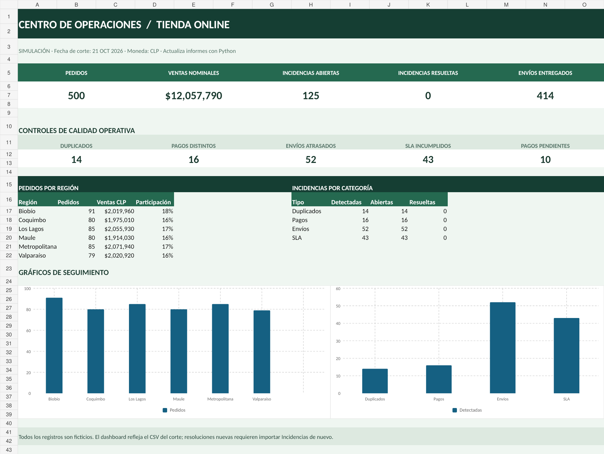

# Centro de operaciones — tienda online

**Proyecto de portafolio · Python + CSV + Google Sheets / LibreOffice Calc · 100 % ficticio**

Sistema demostrativo que simula la operación de una tienda con **500 pedidos**, pagos,
envíos y 120 tickets de soporte. Detecta riesgos y anomalías, emite un informe diario,
ofrece un panel de indicadores y permite registrar la resolución de casos sin eliminar
la evidencia original.

## Vista rápida



[▶ Ver demostración subtitulada de tres incidencias (47 segundos)](evidencias/demo_tres_incidencias.mp4)

**Resultados de ejemplo (corte 2026-10-21):** 500 pedidos; 14 posibles duplicados;
16 pagos con diferencias; 52 envíos atrasados; 43 incumplimientos SLA;
125 incidencias detectadas (antes de documentar resoluciones).

> Todos los datos fueron **generados por código**. No son clientes reales ni ventas reales.
> La cantidad de incidencias cambia con la fecha de corte o la bitácora de resoluciones.

## Estructura del repositorio

```text
centro-operaciones-tienda/
├── data/
│   ├── pedidos.csv            # 500 registros
│   ├── pagos.csv              # 500 registros
│   ├── envios.csv             # 500 registros
│   ├── tickets.csv            # 120 registros
│   └── resoluciones.csv       # historial de decisiones, inicialmente vacío
├── scripts/
│   ├── generar_datos.py       # datos sintéticos reproducibles
│   ├── analizar.py            # 4 controles + informe diario
│   └── gestionar.py           # documentar resolución o reapertura
├── tests/test_controles.py
├── reports/                   # CSV, JSON y Markdown emitidos por Python
├── evidencias/                # vista previa del panel
├── docs/                       # explicación de controles, casos y publicación
├── panel_operaciones.xlsx      # planilla para Google Sheets / Calc
└── ejecutar_informe.bat        # ejecución diaria en Windows
```

## 1. Ejecución en Windows (sin instalar paquetes)

Necesitas **Python 3.10 o posterior**. Abre PowerShell dentro de la carpeta raíz:

```powershell
py -3 scripts/analizar.py --as-of 2026-10-21
```

En Linux/macOS usa `python3` en lugar de `py -3`.

Se actualizan estos archivos:

- `reports/incidencias.csv` — catálogo auditable de hallazgos y su estado.
- `reports/indicadores.json` — métricas estructuradas.
- `reports/informe_2026-10-21.md` — informe fechado.
- `reports/informe_ultimo.md` — versión más reciente.

Para usar la fecha actual, ejecuta:

```powershell
py -3 scripts/analizar.py
```

Los CSV son una **foto fija** de la simulación; sin incorporar pedidos reales nuevos,
los resultados basados en fechas evolucionarán de manera artificial después del corte.
Para la demostración y la comparación de cifras, usa `--as-of 2026-10-21`.

Opcional: regenera el conjunto ficticio con la misma semilla:

```powershell
py -3 scripts/generar_datos.py
```

Esto reemplaza pedidos, pagos, envíos y tickets por el dataset de demostración,
pero **no borra** `data/resoluciones.csv`.

## 2. Examinar el panel en Google Sheets o LibreOffice Calc

Abre `panel_operaciones.xlsx` en LibreOffice Calc, o en Drive sube el archivo,
haz clic derecho **Abrir con → Hojas de cálculo de Google** y, si lo deseas,
guárdalo como archivo de Sheets. Incluye:

| Hoja | Contenido |
|---|---|
| `Panel` | Indicadores, distribuciones y gráficos |
| `Resumen_cruzado` | Matriz por región/categoría, con fórmulas tipo tabla dinámica |
| `Pedidos` | 500 registros sintéticos |
| `Pagos` | 500 pagos |
| `Envios` | 500 envíos |
| `Tickets` | 120 tickets y SLA |
| `Incidencias` | Hallazgos detectados, estado y acción |
| `Parametros` | Fecha de corte y criterios |
| `Guia` | Orientación dentro del archivo |

**Tabla dinámica nativa:** la hoja `Resumen_cruzado` es una matriz de agregación
**con fórmulas** (no un objeto PivotTable). Si necesitas una tabla dinámica nativa
editable en Sheets/Calc, créala siguiendo `docs/publicar.md`. Se incluye el resumen
para que la planilla tenga análisis útil desde el primer momento.

**Actualización:** la planilla entregada refleja un snapshot. Al ejecutar Python
se actualizan los informes y el archivo `reports/incidencias.csv`, **no se sincroniza
sola la planilla**. Para reflejar resoluciones en Sheets, vuelve a importar la hoja
`Incidencias` desde ese CSV (o configura una automatización externa).

## 3. Investigación y resolución de tres incidencias

Primero examina `reports/incidencias.csv` y documenta acciones. Ejemplo:

```powershell
py -3 scripts/gestionar.py PAGO_DIFERENTE:PAG-0012 --responsable "Analista demo" --accion "Reconciliado con comprobante simulado; ajuste derivado a finanzas"
py -3 scripts/gestionar.py POSIBLE_DUPLICADO:PED-0035 --responsable "Analista demo" --accion "Confirmada compra duplicada; segundo pedido bloqueado para revisión"
py -3 scripts/gestionar.py ENVIO_ATRASADO:ENV-0020 --responsable "Analista demo" --accion "Transportista contactado; cliente informado y nueva fecha acordada"
py -3 scripts/analizar.py --as-of 2026-10-21
```

Estas acciones son **ejemplos operativos simulados**. No realizan reembolsos,
bloqueos ni contactos reales. Las anomalías históricas siguen apareciendo como
«detectadas», mientras su estado pasa a `RESUELTO`. Para reabrir:

```powershell
py -3 scripts/gestionar.py PAGO_DIFERENTE:PAG-0012 --estado ABIERTO --responsable "Analista demo" --accion "Se requiere nueva validación"
```

La última entrada del historial determina el estado; las anteriores permanecen
para auditoría. Consulta `docs/casos.md` para el procedimiento y el guion del video.

## 4. Automatización diaria

**Windows (Programador de tareas):**

1. Abre «Programador de tareas» → «Crear tarea básica».
2. Frecuencia: **diariamente**; selecciona la hora que quieras.
3. Acción: «Iniciar un programa».
4. Programa: ruta absoluta a `ejecutar_informe.bat` dentro de este proyecto.
5. En «Iniciar en» usa la ruta de la carpeta raíz, **sin comillas**.
6. Ejecuta la tarea manualmente y comprueba `reports/ejecuciones.log` y
   `reports/informe_ultimo.md`.

**Linux (cron):** sustituye `/ruta/al/proyecto` por la ruta absoluta:

```cron
0 9 * * * cd /ruta/al/proyecto && /usr/bin/python3 scripts/analizar.py >> reports/ejecuciones.log 2>&1
```

Ambas opciones ejecutan el análisis sin intervención, pero no reciben pedidos
nuevos por sí solas: es una **simulación**, no una integración con e-commerce.

## 5. Pruebas

```powershell
py -3 -m unittest discover -s tests -v
```

Las pruebas verifican los 500 pedidos, los 4 tipos de controles, IDs únicos
de incidencias y consistencia de indicadores.

## 6. Evidencia pública solicitada

- [x] Código fuente y dataset CSV ficticio, listos para un repositorio GitHub.
- [x] Planilla con panel y gráficos descargable.
- [x] Vista previa en PNG para agregar al README.
- [x] Informe diario automatizable con Python.
- [x] Casos reproducibles y video explicativo subtitulado generado con datos sintéticos.
- [ ] Repositorio **publicado** en la cuenta del autor.
- [ ] Google Sheet **compartido en solo lectura** desde la cuenta del autor.
- [ ] Captura real en Sheets/Calc y, si se desea, video de pantalla **grabado** por el autor con su explicación.

Consulta [docs/publicar.md](docs/publicar.md) para completar la publicación y la evidencia externa.

## Alcances y límites

- Moneda CLP; tiempos SLA en horas corridas (no horario hábil).
- Los duplicados son **indicios**, no evidencia concluyente de doble cobro.
- Un pago `PENDIENTE` o `RECHAZADO` no se clasifica como diferencia contable.
- Un incumplimiento SLA puede ser histórico aunque el ticket ya haya recibido respuesta.
- Las incidencias se detectan por reglas; la investigación es humana y se audita.
- CSV es la fuente de verdad de la demo. No hay base de datos, API ni conexiones reales.

**Licencia:** MIT.
